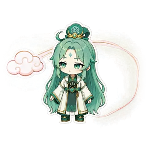

# Clawd Themes

Clawd 的官方与经审核社区主题分发仓库。

本仓库用于发布可按需下载、可卸载的主题。大型主题资源不会进入
[`clawd-on-desk`](https://github.com/rullerzhou-afk/clawd-on-desk) 的应用安装包；
每个主题将以独立、固定版本的 GitHub Release asset 发布，并由小型 catalog 描述版本、大小、预览图和 SHA-256。

## 社区投稿

投稿指南与讨论在主仓库：[中文指南](https://github.com/rullerzhou-afk/clawd-on-desk/blob/main/docs/guides/contributing-themes.zh-CN.md) / [English guide](https://github.com/rullerzhou-afk/clawd-on-desk/blob/main/docs/guides/contributing-themes.md)。维护者按主仓库的[发布流程](https://github.com/rullerzhou-afk/clawd-on-desk/blob/main/docs/project/theme-publishing.md)处理审核后的 metadata、Release 和 catalog。

社区条目在 manifest 和 catalog 中使用 `category: "community"` 和必填的 `author`；未指定 category 的旧条目继续按 official 处理。展示页选填，若提供仍需符合现有的固定地址规则。来源可位于 `rullerzhou-afk` 账号下保留的公开作者仓库，使用固定提交和安全的相对目录（仓库根目录写空字符串）。Release 下载地址、完整性检查和逐文件来源核对保持不变。

包含社区署名支持的 Clawd 版本会单列社区主题并显示作者；旧版应用仍可能显示「官方」。本次工具支持不代表已有新的社区作品发布，现有 catalog 与主题包没有变动。

## 已发布主题

| 主题 | 版本 | 说明 | 下载 |
| --- | --- | --- | --- |
| [Hash Sage（哈希仙人）](themes/hash-sage/README.md) | `1.0.0` | 乘云而行的像素仙人 | [GitHub Release](https://github.com/rullerzhou-afk/clawd-themes/releases/tag/hash-sage-v1.0.0) |
| [Whale-chan（鲸鱼娘）](themes/whale-chan/README.md) | `1.0.2` | 摇着鲸尾的蓝发桌面伙伴 | [GitHub Release](https://github.com/rullerzhou-afk/clawd-themes/releases/tag/whale-chan-v1.0.2) |

Clawd 通过 [`catalog-v1.json`](catalog-v1.json) 读取正式主题版本、大小和 SHA-256。Release 中的版本化主题包不会原地替换。

[查看完整动画展示](https://hash-sage.clawdondesk.com/)

[查看完整动画展示](https://whale.clawdondesk.com/)

## 版权与许可

Clawd 应用的源代码单独以 **AGPL-3.0-only** 许可发布。该源代码许可**不自动适用于**本仓库发布的角色设计、美术、动画、预览图、品牌元素或主题资源包。

### Hash Sage（哈希仙人）

**Copyright (c) 2026 鹿鹿 (rullerzhou-afk). All rights reserved.**

Hash Sage 的角色设计、美术、动画及主题资源均保留全部权利。公开展示、提供下载或通过 Clawd 安装，不代表转让所有权，也不授予复制、重新打包、再分发、转售或用于其他项目的权利。获得权利人另行书面许可的情况除外。

Hash Sage 的视觉方向包含对 OpenAI Codex logo 的致敬。Codex、OpenAI 及相关名称和标识归其各自权利人所有。本项目与 OpenAI 无官方关联，也未获得 OpenAI 的赞助或背书。

### Whale-chan（鲸鱼娘）

原始角色形象、设定与上游素材的权利归各自原作者所有。本主题署名上游项目 [Neko3000/deepseek-whalechan](https://github.com/Neko3000/deepseek-whalechan) 所列的 ZipZipPipe 与上善无形。

鹿鹿（rullerzhou-afk）新作的动画、特效和文字，在有权授权范围内采用 **CC BY-NC-SA 4.0**。本许可不改变原作者及其他权利人的权利；完整条款与署名见 [主题 LICENSE](themes/whale-chan/LICENSE)。本主题是非官方、非商业同人作品，与 DeepSeek 无关联，也未获其授权或背书。

主题包中如包含适用的第三方许可或声明，以包内随附文件为准。

---

This repository distributes optional official and reviewed community themes for Clawd.

Clawd application source code is separately licensed under **AGPL-3.0-only**. That source-code license does **not automatically apply** to character designs, artwork, animation, previews, branding, or theme packages distributed here.

### Hash Sage

**Copyright (c) 2026 鹿鹿 (rullerzhou-afk). All rights reserved.**

All rights in the Hash Sage character design, artwork, animation, and theme assets are reserved. Public display, download availability, or installation through Clawd does not transfer ownership or grant permission to copy, repackage, redistribute, resell, or use the assets in another project without separate written permission from the rights holder.

Hash Sage's visual direction includes a tribute to the OpenAI Codex logo. Codex, OpenAI, and related names and marks belong to their respective owners. This project is not affiliated with, sponsored by, or endorsed by OpenAI.

### Whale-chan

Rights in the original character design, setting and upstream materials remain with their respective creators. This theme credits ZipZipPipe and 上善无形 as named by [Neko3000/deepseek-whalechan](https://github.com/Neko3000/deepseek-whalechan).

New animation, effects and documentation by 鹿鹿 (rullerzhou-afk) are licensed under **CC BY-NC-SA 4.0** to the extent they can be licensed here. This does not change the rights of original creators or other rights holders; see the [theme LICENSE](themes/whale-chan/LICENSE) for full terms and credits. This is an unofficial, non-commercial fan work, unaffiliated with and neither authorised nor endorsed by DeepSeek.

Any applicable third-party notices included inside a theme package continue to govern their respective materials.
